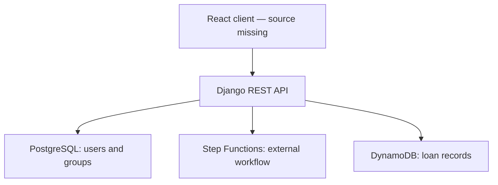

# Online Loan Service

**Service design and a Django REST backend for an AWS-based bank loan application workflow.**

Academic project developed for **Service Engineering (Engenharia de Serviços), University of Coimbra, 2024/2025**. It connects the design of a customer-facing loan service with implementation work on authentication, workflow orchestration and loan management.

The repository combines two stages of the same project:

1. **Service design — Meta 1:** personas, happy-path and exception journey maps, stakeholder mapping, expectation maps and revision notes.
2. **Implementation — ES-Project:** a Django REST API integrating PostgreSQL, AWS Step Functions and DynamoDB, together with the supplied React/Vite frontend configuration.

> **Source completeness:** the supplied archive does not include the React `src/` directory, AWS Step Functions definition or Lambda source code. This repository preserves the available work; it is not a complete, independently runnable full-stack application.

## Project scope

The designed service lets a customer request a bank loan and follow its progress while a loan officer reviews the application, requests an interview or records a final decision. The design artifacts consider both successful journeys and service exceptions, with different levels of customer digital literacy.

The available backend implements:

- User registration and JWT access/refresh token endpoints using Django REST Framework and SimpleJWT.
- Submission of loan amount, duration and monthly income to an AWS Step Functions execution.
- Retrieval of workflow status and output.
- Reading pending and completed applications from DynamoDB.
- Loan detail retrieval and status updates, including proposed interview dates.
- Recording a customer's interview choice and monitoring a final decision.
- Group-based checks on selected manager endpoints using the `gerentes` group.

The original assignment also describes facial recognition, document submission, scoring and notifications. These requirements must not be confused with verified features of the supplied source: no Rekognition flow, scoring implementation or notification workflow can be reproduced from this package alone.

## Technology stack

| Area | Technologies evidenced in the supplied files |
| --- | --- |
| API | Python, Django 5.1, Django REST Framework |
| Authentication | Django users/groups, SimpleJWT |
| Cloud integration | Boto3, AWS Step Functions, DynamoDB |
| Relational storage | PostgreSQL; original settings targeted Amazon RDS |
| Deployment configuration | AWS Elastic Beanstalk WSGI configuration |
| Frontend configuration | React 18, Vite 6, Axios, Chakra UI; component source missing |
| Service design | Personas, journey maps, stakeholder map, expectation maps |

## Architecture



The Django backend starts and polls a state machine, and reads or updates loan records directly in DynamoDB. The internal workflow and any Lambda functions are external dependencies, not included infrastructure definitions.

## Repository structure

| Directory | Purpose |
| --- | --- |
| [`backend/`](backend/) | Django entry point, dependencies and environment template |
| [`backend/api/`](backend/api/) | Views, serializers, access decorators and API routes |
| [`backend/backend/`](backend/backend/) | Django settings and application entry points |
| [`backend/.ebextensions/`](backend/.ebextensions/) | Supplied Elastic Beanstalk WSGI setting |
| [`frontend/`](frontend/) | Original package manifest, lockfile and frontend configuration |
| [`docs/service-design/`](docs/service-design/) | Meta 1 deliverables and revisions |

### Explore the service design

| Artifact | Documents |
| --- | --- |
| Personas | [Ana Maria](docs/service-design/personas/ana-maria-persona.pdf), [João Pedro](docs/service-design/personas/joao-pedro-persona.pdf) |
| Happy-path journeys | [Ana Maria](docs/service-design/journey-maps/happy-journey-map-ana-maria.pdf), [João Pedro](docs/service-design/journey-maps/happy-journey-map-joao-pedro.pdf) |
| Exception journeys | [Ana Maria](docs/service-design/journey-maps/exception-journey-map-ana-maria.pdf), [João Pedro](docs/service-design/journey-maps/exception-journey-map-joao-pedro.pdf) |
| Expectation maps | [Ana Maria](docs/service-design/expectation-maps/ana-maria-expectations.pdf), [João Pedro](docs/service-design/expectation-maps/joao-pedro-expectations.pdf) |
| Stakeholders | [Stakeholder map](docs/service-design/stakeholders/stakeholder-map.pdf) |
| Feedback revisions | [Original revision notes, in Portuguese](docs/service-design/revision-notes.txt) |

These are service-design personas, not an application user database. The original PDF content has been preserved.

## Backend setup

The following describes configuration of the available backend. It does not provision cloud infrastructure or restore missing frontend code.

### Prerequisites

- Python 3.10 or newer compatible with the pinned dependencies.
- A PostgreSQL server and an empty database you create for this project.
- Your own AWS credentials or IAM role, and the required AWS resources.
- A DynamoDB table matching the implementation: by default `LoanDecisions`, with string partition key `email` and string sort key `timestamp`.
- A compatible Step Functions state machine. Its ARN is provided through `STEP_FUNCTION_ARN`.

### Configure the environment

From the repository root, on Windows PowerShell:

```powershell
cd backend
python -m venv .venv
.\.venv\Scripts\Activate.ps1
python -m pip install -r requirements.txt
Copy-Item .env.example .env
```

On macOS/Linux, activate with `source .venv/bin/activate` and copy with `cp .env.example .env` instead.

Edit `.env` with your own PostgreSQL connection values and a new `DJANGO_SECRET_KEY`. Set `DB_SSLMODE=require` if your remote database requires TLS. The template enables debugging for local development only.

Configure AWS authentication through a local AWS profile, an IAM role or exported environment variables. For temporary credentials, export `AWS_ACCESS_KEY_ID`, `AWS_SECRET_ACCESS_KEY` and `AWS_SESSION_TOKEN` together. AWS clients are created at module import, so valid local SDK configuration is needed even for some Django management commands. The AWS resources themselves must exist before exercising loan endpoints.

Then run:

```bash
python manage.py check
python manage.py migrate
python manage.py createsuperuser
python manage.py runserver
```

The API runs at <http://127.0.0.1:8000/>. The root returns `API Backend`; it does not serve a complete frontend. Configure the `gerentes` group and assign intended manager accounts through Django administration when testing manager endpoints.

### Frontend status

The `frontend/` folder includes the dependency files and Vite configuration, but `index.html` references `/src/main.jsx`, which was not supplied. Restore the original `src/` and any required public assets before attempting to build or start the UI. See [frontend notes](frontend/README.md).

## Main API routes

All paths below are relative to the backend origin.

| Method | Path | Purpose |
| --- | --- | --- |
| POST | `/api/user/register/` | Register an account |
| POST | `/api/token/` | Obtain JWT tokens; the `username` field carries the email |
| POST | `/api/token/refresh/` | Refresh an access token |
| POST | `/api/logout/` | Clear token cookies |
| POST | `/api/start-loan-workflow/` | Submit `amount`, `duration` and `income` |
| GET | `/api/check-loan-workflow-status/` | Poll an execution using `executionArn` |
| GET | `/api/pending-loans/` | List pending applications |
| GET | `/api/completed-loans/` | List completed applications |
| GET | `/api/loans/<email>/<timestamp>/` | Retrieve an application |
| PUT | `/api/loans/<email>/<timestamp>/update/` | Update its decision or interview dates |
| GET | `/api/monitor-loan-status/` | Monitor a customer's application using `timestamp` |
| POST | `/api/update-client-choice/` | Record an interview choice |
| GET | `/api/monitor-final-decision/` | Monitor the final decision using `email` and `timestamp` |

Protected endpoints expect `Authorization: Bearer <access-token>`.

## Limitations and validation

This is an academic implementation, not production banking software.

- Frontend source and cloud workflow/function definitions need to be restored for end-to-end reproduction. No deployed demo is claimed.
- The supplied authentication uses Django and SimpleJWT, whereas the assignment requested a custom educational authentication implementation. The README describes the code as supplied, not full compliance with every assignment requirement.
- Authorization needs review: the loan update route allows anonymous access, and some endpoints accept client-supplied record identifiers without complete ownership checks.
- Several status endpoints poll in a blocking loop without a request-level deadline; DynamoDB scans do not handle pagination.
- The logout endpoint clears cookies but does not revoke already-issued bearer tokens.
- The duplicate-registration branch references an unimported `ValidationError`.
- `api/tests.py` is a scaffold, not a functional test suite. No benchmark, security audit or end-to-end test result is claimed.

For this packaging pass, Python files were syntax-checked, relative documentation links were checked, and the archive was checked for integrity. No live AWS calls, database migrations or complete application execution were performed.

## Packaging changes

- Merged the service-design stage and implementation into one repository.
- Renamed document folders/files consistently while preserving the PDFs and original revision notes.
- Removed installed `node_modules`, generated frontend bundles, local `.env` files and a user-data backup.
- Replaced hard-coded database credentials, the Django signing secret, deployment host and local filesystem paths with portable configuration.
- Added `.env.example` and a root `.gitignore`.
- Retained the PostgreSQL binary driver; removed the duplicate source driver and the unused MySQL driver from the dependency list.
- Preserved migrations and the original frontend lockfile. Business logic was not rewritten.

The assignment handout was used as context and is not bundled as a project deliverable.

## Academic context and attribution

Collaborative coursework, University of Coimbra, Service Engineering, academic year 2024/2025. The service-design documents identify **Group 7**. This packaging does not attribute all work to one person; original group labels remain in the documents.
